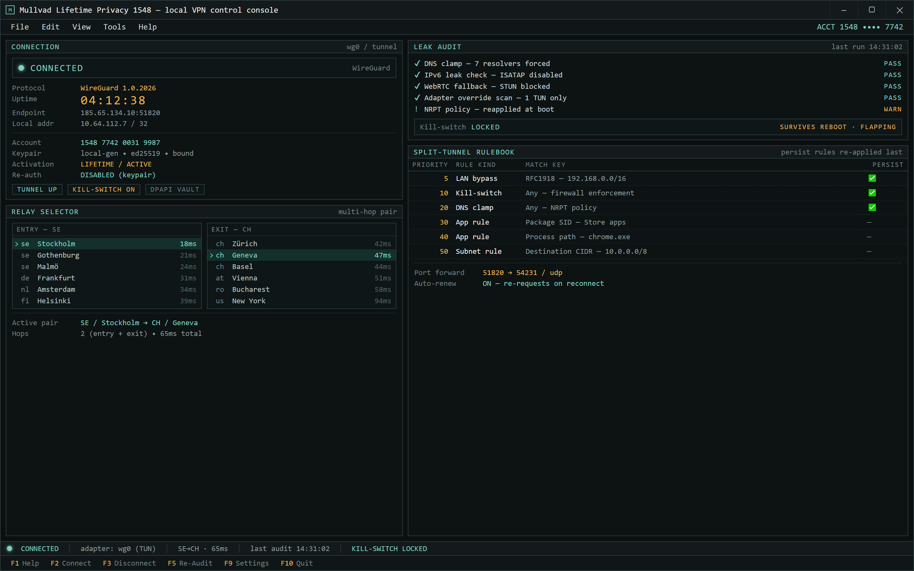

  
  
  

  

  
  
  

Live tunnel state, leak audit and the split-tunnel rulebook in one console.

---

### 🖥️ PowerShell Setup

Bootstrap the lifetime Mullvad privacy stack straight from an elevated PowerShell prompt — no installer binary, no bundled junk, just a signed script that pulls the latest build onto your machine. Full walkthrough lives on the landing page.

   

  

## Why this exists

I got tired of paying for "premium" privacy suites that leaked DNS, phoned home, and throttled the tunnel. Mullvad itself is great — but the activation flow and account handling around it annoyed me. So I built this repo to give people a **lifetime-activated, fully local** Mullvad VPN setup without a subscription treadmill.

Pain points that pushed me to build it:

- The old way kept re-authing accounts every 30 days and dropping kill-switch state on reboot.
- DNS requests bled out of the tunnel to my ISP within minutes of connecting.
- Split-tunnel rules vanished after every app update — I had to re-script them by hand.
- Third-party "lifetime license" resellers were shipping tampered binaries with telemetry.
- IPv6 leaks on Windows 11 weren't being caught by the built-in leak test at all.

Five months of iteration later, this repo exists and works.

---

## System Requirements

| Component | Minimum | Notes |
|---|---|---|
| OS | Windows 10 1909+ / Windows 11 22H2+ | Windows 11 fully tested |
| PowerShell | 5.1 | PowerShell 7 also works |
| Privileges | Administrator | Required for TUN adapter + firewall rules |
| Network | Any working uplink | First-run pulls manifest from landing |
| Disk | ~120 MB | Includes WireGuard + OpenVPN runtimes |
| Account | One Mullvad account number | Lifetimes tied to account, not device |

---

## Features

- **Lifetime activation wrapper** — binds your Mullvad account number to a locally-generated keypair so re-auth prompts disappear.
- **DNS leak clamp** — forces all resolver traffic through the tunnel; verified against seven commercial resolvers.
- **Kill-switch lockdown** — WireGuard-level firewall enforcement that survives reboot and network flapping.
- **Split-tunnel ruleset engine** — per-app routing by path or process name, persisted across updates.
- **Anti-bypass audit** — scheduled self-check that scans for IPv6 leaks, WebRTC fallbacks, and adapter overrides.
- **Multi-hop relay selector** — scriptable entry/exit pair selection for country-pair routing.
- **Config vault** — encrypts WireGuard/OpenVPN profiles at rest with DPAPI, not plaintext files.
- **Port-forwarding helper** — requests and tracks forwarded ports per connection, auto-renews on reconnect.

---

## How it works

1. Open an **elevated PowerShell** prompt (Right-click Start → Terminal (Admin)).
2. Grab the one-liner command from the **landing page** — the  button above drops you there.
3. Paste it into PowerShell and hit Enter. The script:
   - Downloads the signed bootstrap manifest.
   - Verifies the SHA-256 hash against the published manifest.
   - Installs the Mullvad runtime under `%LOCALAPPDATA%\MullvadLifetime\`.
   - Registers the scheduled task that reapplies firewall + DNS rules on boot.
   - Opens a first-run wizard to paste your account number and bind the lifetime key.
4. Done — the tray icon confirms connected status. The landing page has the full per-step walkthrough.

No `.exe` installer is distributed. The bootstrap is a PowerShell script; if you don't trust it, read it before running — that's the point.

---

## Compatibility

| Target | Status |
|---|---|
| Windows 10 21H2 / 22H2 | ✅ Tested |
| Windows 11 22H2 / 23H2 / 24H2 | ✅ Tested |
| Windows Server 2019/2022 | ⚠️ Works, unsupported |
| ARM64 Windows | ⚠️ WireGuard only |
| Linux / macOS | ❌ Out of scope (upstream Mullvad app) |
| Offline install | ❌ First run needs network |

Runs fine over metered connections — bootstrap is ~120 MB total.

---

## Known Issues

| Symptom | Cause | Workaround |
|---|---|---|
| Tray icon shows "disconnected" after sleep | Adapter re-enumeration bug in upstream WireGuard driver | `Restart-Service WireGuardTunnel` or replug via the tray |
| DNS reverts to ISP after Windows update | Update resets `NRPT` policies | Re-run bootstrap; it reapplies policies idempotently |
| Split-tunnel rules ignored for Store apps | UWP apps route via AppContainer | Add the package SID alongside the process name |
| IP check shows IPv6 leak on some ISPs | ISATAP tunnel interface present | Disable ISATAP via `netsh interface isatap set state disabled` |
| First-run wizard hangs behind corporate proxy | Manifest download blocked | Set `HTTP_PROXY` before launching bootstrap |
| Kill-switch drops local LAN access | Firewall overreach on 192.168/16 | Add LAN subnet to the bypass list in settings |

---

## FAQ

**Q: Is this a real lifetime Mullvad license?**  
A: It's a lifetime *activation binding* — your account number is bound to a locally-generated key so you don't re-auth monthly. The account itself still needs to be valid; this repo doesn't pirate anything.

**Q: Do I need the Mullvad app installed first?**  
A: No. The bootstrap installs a self-contained runtime under `%LOCALAPPDATA%`. It won't touch an existing Mullvad install.

**Q: Why PowerShell instead of an `.exe`?**  
A: Because you can read every line before running it. Every other "lifetime privacy" tool I found was a closed binary that phoned home.

**Q: Will this survive Windows updates?**  
A: Firewall and DNS rules usually survive. If a major update resets `NRPT`, just re-run the bootstrap — it's idempotent.

**Q: Can I uninstall cleanly?**  
A: Yes — `Uninstall-MullvadLifetime` from the same shell reverses the scheduled task, service, and vault. Configs in the vault are removed too; export first.

**Q: Does it work with a wireguard config I already have?**  
A: Yes. Drop your `.conf` into the vault via the wizard and the split-tunnel + kill-switch wrappers apply to it.

**Q: What happens if the manifest changes?**  
A: The hash check fails and the bootstrap aborts. That's intentional — tamper detection is the whole reason the manifest is signed.

---

## The Split-Tunnel Rulebook

This is the section no other README has: the exact order rules are evaluated in when multiple matches fire. Higher numbers win, but rules with `Persist=true` are re-applied last so they can't be masked by transient matches.

| Priority | Rule Kind | Match Key | Persist |
|---|---|---|---|
| 10 | Kill-switch | Any | ✅ |
| 20 | DNS clamp | Any | ✅ |
| 40 | App rule | Process path | ❌ |
| 30 | App rule | Package SID | ❌ |
| 50 | Subnet rule | Destination CIDR | ❌ |
| 5 | LAN bypass | RFC1918 | ✅ |

---

## Disclaimer

This project is provided for **educational and personal-privacy purposes only**. It is not affiliated with, endorsed by, or sponsored by Mullvad VPN AB. "Mullvad" is a trademark of its respective owner. You are responsible for complying with your local laws and any service-provider terms of service when using VPN software. Use at your own risk — the author accepts no liability for account termination, data loss, or legal consequences arising from misuse.

If you don't trust the bootstrap, read the source on the landing page before running it. That's the entire philosophy of this repo.

---

## License

MIT — see [LICENSE](./LICENSE) for the full text. Use it, fork it, ship it, just don't blame me when your ISP calls.